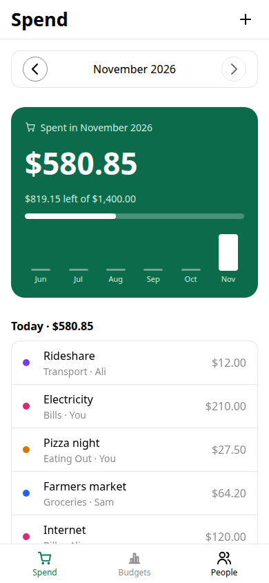
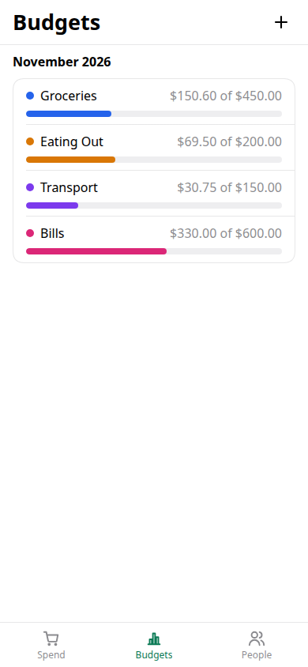
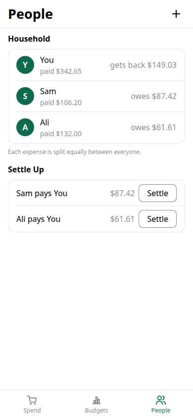
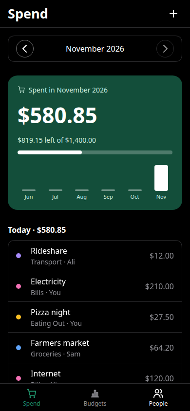
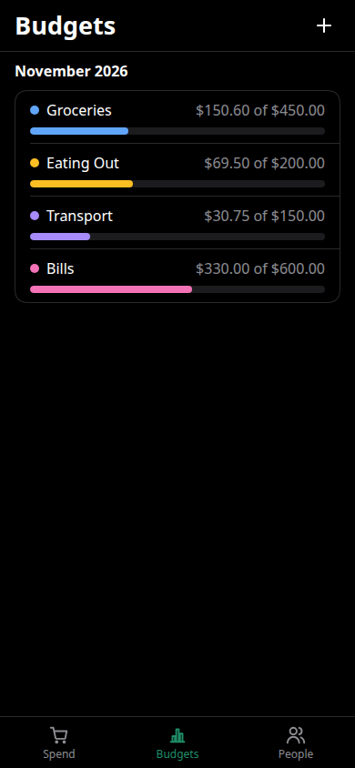
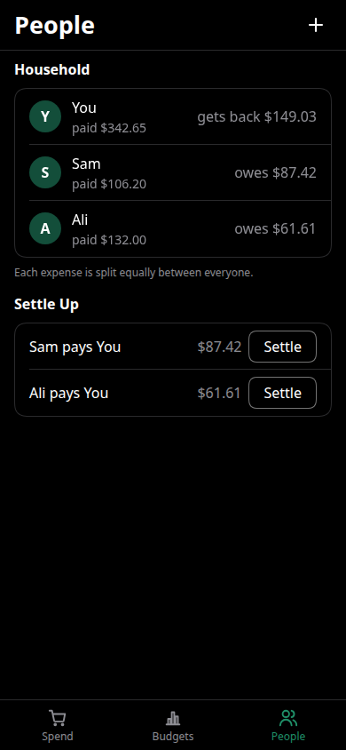

<div align="center">

# Tide

**A shared expense and budget tracker for households, built with the [Exact](https://github.com/expo/exact) framework.**

Track what you spend, keep each category under its monthly limit, and settle up with the people you live with in the fewest payments.






</div>

## Features

**Spend.** Log an expense in a few taps: amount, category, who paid and a note. Each month shows the total spent, what is left of the budget, and a six-month bar chart to compare against.

**Budgets.** Every category has a monthly limit with a colour-coded progress bar, and the app warns you when one goes over. You can add, rename or re-limit categories at any time, and a duplicate name is refused.

**People.** Add the people in your household and every expense is split equally between them, with odd cents going to someone so the shares always add up. Tide works out the fewest payments that even everyone out, and one tap settles each one.

**Everywhere.** It runs as a web app, a Linux desktop app and an Android app from one codebase, follows the system's light or dark mode, and keeps your data on your device across relaunches.

<details>
<summary><b>Dark mode</b></summary>
<br />
<div align="center">



</div>
</details>

## Getting started

Tide uses an [Exact](https://github.com/expo/exact) checkout next to it, at `../exact`. You can point `EXACT2` somewhere else instead.

```sh
git clone https://github.com/expo/exact.git
git clone https://github.com/Luqman-Khokhar/tide-exact.git
cd tide-exact

bun exact.mjs web          # dev server, reloads on save
bun exact.mjs test         # run app.test.contract
bun exact.mjs verify       # build, test, and check every screen in light and dark
```

To make a production build for the web:

```sh
bun run build              # writes dist/
bun run start              # serves dist/ the way a static host would
```

To build the native apps:

```sh
bun exact.mjs linux
bun exact.mjs android      # builds the APK and installs it on a connected device
```

Run `bun ../exact/scripts/exact.mjs setup --check` to see what a native build still needs.

## How it's built

| File | Role |
|------|------|
| `app.contract` | The view: three tabs (Spend, Budgets, People), sheets and every state, written in Exact's Contract language |
| `app.ts` | The data module: loads the month, saves expenses, categories and members, and works out balances and settlements |
| `app.test.contract` | End-to-end tests that drive the real UI: adding, editing, splitting, settling, relaunching |
| `app.tamber` | The design tokens: brand green, category colours, light and dark values |
| `app.json` | The manifest: app id, name and target platforms |

Amounts are stored as whole cents, so the totals never drift. Data lives in a single JSON file in the app's sandbox, written atomically. To settle up, the person who owes the most pays the person owed the most, and this repeats until everyone is even.

## Contributing

Issues and pull requests are welcome. Before you open a PR, make sure `bun exact.mjs verify` ends with `verify: clean`.

## Acknowledgements

Built on [Exact](https://github.com/expo/exact). If Tide helped you learn the framework, a ⭐ helps other people find it.
